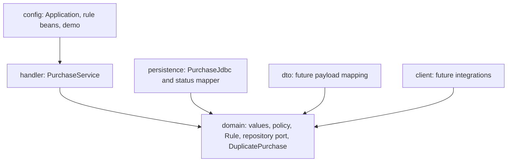

# Purchase Tracker — Lab 4

Purchase requests move from drafting through approval to ordering. Lab 4 adds a REST contract to the same semester product and PostgreSQL persistence from Labs 1–3.

## Requirements

- JDK 21 and Maven 3.9 or later.
- PostgreSQL 16 (the provided Compose file starts only the database).
- Docker with Compose for the commands below, or an existing local PostgreSQL installation.
- Run commands from the folder containing `pom.xml`.

## Quick start

On the Lab 4 branch, start the classroom database or use your local PostgreSQL instance.

```sh
docker compose up -d --wait
mvn -q verify
mvn spring-boot:run
```

Open [Swagger UI](http://localhost:8080/swagger-ui.html), [OpenAPI JSON](http://localhost:8080/v3/api-docs), or [health](http://localhost:8080/actuator/health). The server stays running until you stop it. Stop the Compose database with `docker compose stop`. The named volume retains its data.

## REST contract

| Request | Outcome |
| --- | --- |
| `POST /api/v1/purchase-requests` | `201 Created` with `Location` and the new purchase |
| `GET /api/v1/purchase-requests/{id}` | `200 OK` with the purchase identified by UUID |
| Blank business key, blank title, title over 120 characters, malformed JSON, or invalid UUID | `400 VALIDATION` |
| A valid UUID without a matching purchase | `404 NOT_FOUND` |
| A business key already stored | `409 DUPLICATE` |
| Unsupported request media type | `415 UNSUPPORTED` |
| Unexpected application failure | `500 INTERNAL` |

POST accepts `businessKey` and `title`. A successful response contains `id`, `businessKey`, `status`, and `title`. New purchases start in `DRAFT`. Use the path in the `Location` header to read the created purchase.

```sh
curl -i http://localhost:8080/api/v1/purchase-requests \
  -H 'Content-Type: application/json' \
  -d '{"businessKey":"PR-LAB4-01","title":"Monitors for room 3"}'
```

Repeat the POST with the same business key to see `409`. In psql, `SELECT count(*) FROM purchase_request WHERE business_key = 'PR-LAB4-01';` returns 1. For a fresh demonstration, choose an unused business key.

Errors contain only `code`, `message`, and `correlationId`. Supply `X-Correlation-Id` to correlate an error with your request. The server generates an ID if the header is missing or blank.

## Profiles and database

The default `dev` profile uses PostgreSQL at `localhost:5432/css` with the classroom credentials `css` / `css`. It configures the downstream client for `http://localhost:9090` with a 2-second timeout. This lab does not send downstream requests.

Set `SPRING_PROFILES_ACTIVE=prod`, `CSS_DB_URL`, `CSS_DB_USER`, and `CSS_DB_PASSWORD` for production. The downstream URL uses a reserved placeholder until configured via `CSS_DOWNSTREAM_BASE_URL`. Set `CSS_DOWNSTREAM_TIMEOUT` to override the 2-second default.

Flyway applies V1 to a fresh database. V1 contains the original Lab 3 SQL byte for byte. The dev profile baselines an existing Lab 3 classroom schema at version 1 so its existing rows remain available. For an existing production schema, verify it matches V1 and explicitly baseline it at version 1 before starting the app.

The Lab 3 JDBC tests use the separate `purchase_tracker_lab3_test` schema. They rebuild its table before each database test. Run one verification process at a time against this database.

To run the Lab 3 transaction demonstration as a one-shot command:

```sh
mvn spring-boot:run "-Dspring-boot.run.profiles=dev,demo" "-Dspring-boot.run.arguments=--spring.main.web-application-type=none"
```

The demo prints `ROLLBACK count = 0`, `COMMITTED count = 1`, and `LAB 3 DEMO PASSED`. Each run deliberately adds one committed example purchase with a fresh key.

## Week 5: prove rollback in psql first

Start PostgreSQL, then apply the same SQL and run the rollback script:

```sh
docker compose up -d --wait
docker compose exec -T postgres psql -U css -d css -v ON_ERROR_STOP=1 -f /lab/migration/V1__purchase_request.sql
docker compose exec -T postgres psql -U css -d css -f /demo/rollback-demo.sql
```

The script performs `BEGIN`, inserts a fresh key twice, checks the expected SQLSTATE `23505`, explicitly issues `ROLLBACK`, and verifies count **0**. The duplicate-key error is expected. Success ends with:

```text
PSQL ROLLBACK PASSED: SQLSTATE 23505; count = 0
```

With a local PostgreSQL installation, run the same files using `psql -h localhost -U css -d css -f <file>`; enter the local password when prompted.

## Identifiers and schema

| Value | Java type | PostgreSQL column | Purpose |
| --- | --- | --- | --- |
| Internal identity | `PurchaseId(UUID)`, created by `newId()` | `id uuid PRIMARY KEY` | Stable surrogate key |
| Human number | `PurchaseKey(String)`, e.g. `PR-19` | `business_key text NOT NULL UNIQUE` | Number shown to people |
| Status | `PurchaseStatus` | `status text NOT NULL` with `CHECK` | DRAFT / APPROVED / ORDERED |
| Description | Validated nonblank title | `title text NOT NULL` | Purchase details |
| Creation time | Database default | `created_at timestamptz NOT NULL DEFAULT now()` | Creation timestamp |

Lab 1's human string identifier and its null/blank validation now live in `PurchaseKey`; `PurchaseId` is the separate UUID identity required by Lab 3. No database from an earlier lab needed migration.

There is one application table, `purchase_request`. The manual psql demonstration and Flyway use the same `V1__purchase_request.sql`; tests drop their isolated table first to validate creation from scratch.

## Purchase status rules

These are the four rows retained in `PurchasePolicyTest` with `@ParameterizedTest` and `@CsvSource`.

| From | To | Result | Business reason |
| --- | --- | --- | --- |
| `DRAFT` | `APPROVED` | Allowed | A manager approves the request. |
| `APPROVED` | `ORDERED` | Allowed | The approved request can be sent to a supplier. |
| `DRAFT` | `ORDERED` | Forbidden | The request cannot bypass manager approval. |
| `ORDERED` | `DRAFT` | Forbidden | A supplier order cannot be reopened as a draft. |

Allowed moves return the target status; forbidden moves throw `IllegalStateException`. The SQL `CHECK` uses the same three statuses. Database mapping rejects unknown text rather than inventing a status.

## Package boundaries

Arrows show dependencies toward the domain:



- `PurchaseService` receives `Rule` and the `PurchaseRepository` outbound port through its constructor.
- `PurchaseRulesConfiguration` wires `UnapprovedCannotOrder` and `TransitionRule`.
- `PurchaseJdbc` implements the port with `JdbcTemplate`; INSERT, count, and lookup use `?` parameters.
- The persistence adapter translates PostgreSQL unique violations into unchecked `DuplicatePurchase`. Other integrity failures are not mislabeled as duplicate keys.
- `@Transactional` is on service methods. The service class is not final so Spring can proxy it.
- The domain contains no Spring or JDBC dependencies. All SQL and row mapping stay in `persistence`.

## Two transaction boundaries, two different counts

| Operation | Transactions | Failure | Committed count |
| --- | --- | --- | --- |
| `service.insertTwice(key)` | One transaction contains both INSERTs | Second INSERT throws `DuplicatePurchase`; the exception escapes | **0** |
| `service.register(id1, key, title)`, then a second registration | One transaction per external service call | First call commits; second call rolls back | **1** |

The repository never deletes the first row to hide a duplicate. No test class or method uses a transactional test wrapper. The two key tests query the result through an independent autocommit JDBC connection after the service returns or throws.

## Verification

```sh
mvn -q verify
```

Use `mvn verify` to display the full test summary and `BUILD SUCCESS`.

| Test | Evidence |
| --- | --- |
| `PurchaseControllerTest` | MVC slice for request validation, REST statuses, response fields, and correlation IDs |
| `DevProfileTest` | Downstream property binding, OpenAPI responses, and Actuator exposure on the dev profile |
| `PurchasePolicyTest` | Four README rows plus other forbidden transitions and null statuses |
| `PurchaseIdTest` / `PurchaseKeyTest` | UUID identity and rejected null/blank identifiers |
| `PurchaseServicePortTest` | Mocked outbound repository; no database or HTTP calls |
| `PurchaseServiceTest` | Spring injects the rule chain and preserves Lab 2 behavior |
| `PurchaseJdbcIntegrationTest.secondStatementRollsBack` | Duplicate domain exception, SQLSTATE 23505, committed count 0 |
| `PurchaseJdbcIntegrationTest.secondRequestKeepsTheFirst` | First row commits, second call fails, count 1, original data unchanged |
| Remaining JDBC / mapper tests | PostgreSQL CHECK and NOT NULL, all statuses round-trip, unknown values rejected, quoted inputs remain data |

GitHub Actions uses Java 21 and real PostgreSQL. It checks domain boundaries, executes the psql rollback demonstration, runs `mvn -q verify`, and starts the Java demonstration. Test reports and demo logs are saved in the `lab4-verification` workflow artifact.

## Hand-in

| Lab | Branch | Pull request |
| --- | --- | --- |
| Lab 2 — Spring Boot and domain rules | [lab-2](https://github.com/argymakmyrzaliyev-star/purchase-tracker/tree/lab-2) | [PR #1](https://github.com/argymakmyrzaliyev-star/purchase-tracker/pull/1) |
| Lab 3 — PostgreSQL, JDBC and transactions | [lab-3](https://github.com/argymakmyrzaliyev-star/purchase-tracker/tree/lab-3) | [PR #2](https://github.com/argymakmyrzaliyev-star/purchase-tracker/pull/2) |

Lab 2 contains the Spring Boot version without database persistence. Lab 3 continues that product with PostgreSQL and JDBC. Its PR compares against `lab-2`; after Lab 2 is merged, the Lab 3 PR can target `main`.

Open the Lab 4 pull request from `lab-4` against the branch that contains Lab 3. Include the Lab 4 Jira story IDs in the title.


### Lab 4 pull request checklist

- [ ] Add the team's Lab 4 story IDs to the PR title.
- [x] Keep Purchase Tracker and its PostgreSQL schema from Labs 1–3.
- [x] Create and read purchase requests under `/api/v1/purchase-requests` using the UUID in the GET path.
- [x] Return 201 with `Location`, 400 `VALIDATION` with the field name, 404 `NOT_FOUND`, and 409 `DUPLICATE`.
- [x] Verify on a running app that the second POST returns 409 and PostgreSQL still holds exactly one row for the key.
- [x] Return only `code`, `message`, and `correlationId` for API errors. Keep exception details in the server log.
- [x] Return a response record and keep Spring and Jakarta Validation out of the domain.
- [x] Publish 201, 400, and 409 for POST and 200 and 404 for GET in Swagger UI.
- [x] Cover 201, 400, 404, 409, and the correlation header in `@WebMvcTest`.
- [x] Read datasource and downstream settings from YAML. Use localhost `css` / `css` in dev and database environment variables in prod.
- [x] Verify that health is 200 with `UP` and that env, beans, heapdump, and shutdown return 404.
- [x] Run the Lab 3 tests and `mvn -q verify` against PostgreSQL.
- [x] Keep Spring Security, an application Dockerfile, and `target/` out of this change.
