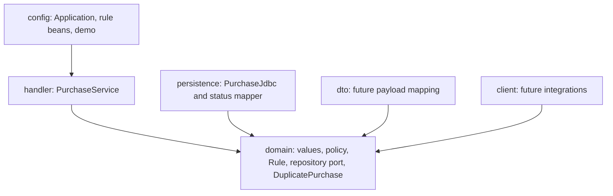

# Purchase Tracker — Lab 5

Purchase requests move from drafting through approval to ordering. Lab 5 adds a two-role approval workflow to the Lab 4 REST API. The request desk runs in the same Spring Boot process as the API.

## Requirements

- JDK 21 and Maven 3.9 or later.
- PostgreSQL 16 (the provided Compose file starts only the database).
- Docker with Compose for the commands below, or an existing local PostgreSQL installation.
- Run commands from the folder containing `pom.xml`.

## Quick start

On the Lab 5 branch, start the classroom database or use your local PostgreSQL instance.

```sh
powershell -ExecutionPolicy Bypass -File .\scripts\start-demo.ps1 -Verify
```

Open the [request desk](http://localhost:8080/) to sign in. The same server hosts [Swagger UI](http://localhost:8080/swagger-ui.html), [OpenAPI JSON](http://localhost:8080/v3/api-docs), or [health](http://localhost:8080/actuator/health). The server stays running until you stop it. Stop the Compose database with `docker compose stop`. The named volume retains its data.

## Local security and startup

The Windows launcher uses the existing `purchase-tracker-demo-db` container on
127.0.0.1:15432. It preserves purchases, rotates the local database password, and
generates new random passwords and a signing key on each run. Stop the previous
application before running it. The dev web server binds to 127.0.0.1 only.
Passwords appear only in the local terminal, never on the web page. Do not record
or share that terminal while demonstrating. Close the launcher when finished.
For another port, pass `-DatabasePort 15433`; an existing container must already
have that exact loopback-only mapping.

For a manual launch on any OS, set `CSS_JWT_SECRET` (32+ random characters),
`CSS_REQUESTER_PASSWORD` and `CSS_APPROVER_PASSWORD` (distinct, 16+ characters),
`CSS_DB_PASSWORD`, and your datasource connection variables before `mvn spring-boot:run`.
These values have no built-in fallback. Keep production keys out of git.
Run `mvn verify` in the same configured environment to check all tests.

Login is limited to ten attempts per direct client address per minute. Logout
revokes the current token; the page only confirms logout after the server responds.
Revocations are in process memory: a multi-instance deployment needs a shared
revocation store, and reusing a signing key after restarting loses revocations.
The supplied launcher rotates the key on each start, invalidating prior tokens.
The two roles still read any request by UUID, as required by this lab; there is
no per-owner isolation. Non-dev login intentionally rejects all credentials until
a real identity provider is implemented. This is a local classroom demo, not a
production deployment. External access requires HTTPS and deployment-specific
identity, secret management, rate limiting, and database permissions.

## Access rules

| Request or action | REQUESTER | APPROVER | No token |
| --- | --- | --- | --- |
| POST `/api/v1/auth/login` | Public (rate limited) | Public (rate limited) | Public (rate limited) |
| POST `/api/v1/auth/logout` | Revoke own token | Revoke own token | 401 |
| POST `/api/v1/purchase-requests` | Create | Create | 401 |
| GET `/api/v1/purchase-requests/{id}` | Read | Read | 401 |
| POST `/api/v1/purchase-requests/{id}/approve` | 403 | Approve a draft | 401 |
| GET `/api/me` | Own identity | Own identity | 401 |
| GET `/actuator/health`, Swagger UI, OpenAPI JSON and the request desk assets | Public | Public | Public |
| Other routes | 403 | 403 | 401 |

### Try both roles in your browser

1. At the request desk, submit a wrong password to see `401 UNAUTHENTICATED`.
2. Sign in with the dev-only account `requester` and the password printed by the local launcher. Create a draft with a fresh business key, then read it. The page fills in its UUID.
3. Click **Approve request**. The API returns `403 FORBIDDEN`; the desk reads the row again so you can compare the two statuses.
4. Sign out and sign in as `approver` and its separate launcher password. Approve the same UUID. It changes from `DRAFT` to `APPROVED`. A second approval returns `409 INVALID_TRANSITION`.
5. Sign out again and read the request. The API returns `401`. The UUID stays visible so both accounts can demonstrate the same purchase.

Login uses BCrypt and issues an HS256 bearer token with issuer `purchase-tracker`, subject, issue and expiry timestamps, and an unprefixed `roles` array. The page uses `GET /api/me` to show the caller. It keeps the token in memory for 900 seconds. Both the HTTP rule and the service method restrict approval to the approver role. The actor comes from the authenticated principal.

## REST contract

| Request | Outcome |
| --- | --- |
| `POST /api/v1/purchase-requests` | `201 Created` with `Location` and the new purchase |
| `GET /api/v1/purchase-requests/{id}` | `200 OK` with the purchase identified by UUID |
| Blank business key, blank title, title over 120 characters, malformed JSON, or invalid UUID | `400 VALIDATION` |
| A valid UUID without a matching purchase | `404 NOT_FOUND` |
| A business key already stored | `409 DUPLICATE` |
| Unsupported request media type | `415 UNSUPPORTED` |
| Unexpected application failure | `500 INTERNAL` |

POST accepts `businessKey` and `title`. A successful response contains `id`, `businessKey`, `status`, and `title`. New purchases start in `DRAFT`. Use the path in the `Location` header to read the created purchase.

Use the signed-in request desk to create a second purchase with the same key. It returns `409 DUPLICATE`. The original row keeps its UUID and status.

Errors contain only `code`, `message`, and `correlationId`. Supply `X-Correlation-Id` to correlate an error with your request. The server generates an ID if the header is missing or blank.

## Profiles and database

The bare `dev` datasource defaults to localhost:5432 and user css, with its password required from `CSS_DB_PASSWORD`; the launcher overrides the port to 15432 and supplies a fresh database password. It configures the downstream client for `http://localhost:9090` with a 2-second timeout. This lab does not send downstream requests.

Set `SPRING_PROFILES_ACTIVE=prod`, `CSS_DB_URL`, `CSS_DB_USER`, `CSS_DB_PASSWORD`, and `CSS_JWT_SECRET` for production. Use a randomly generated signing secret of at least 32 characters. Only the dev profile provisions the two classroom accounts. The downstream URL uses a reserved placeholder until configured via `CSS_DOWNSTREAM_BASE_URL`. Set `CSS_DOWNSTREAM_TIMEOUT` to override the 2-second default.

Flyway applies V1 to a fresh database. V1 contains the original Lab 3 SQL byte for byte. The dev profile baselines an existing Lab 3 classroom schema at version 1 so its existing rows remain available. For an existing production schema, verify it matches V1 and explicitly baseline it at version 1 before starting the app.

The Lab 3 JDBC tests use the separate `purchase_tracker_lab3_test` schema. They rebuild its table before each database test. Run one verification process at a time against this database.

To run the Lab 3 transaction demonstration as a one-shot command:

```sh
mvn spring-boot:run "-Dspring-boot.run.profiles=dev,demo" "-Dspring-boot.run.arguments=--spring.main.web-application-type=none"
```

The demo prints `ROLLBACK count = 0`, `COMMITTED count = 1`, and `LAB 3 DEMO PASSED`. Each run deliberately adds one committed example purchase with a fresh key.

## Week 5: prove rollback in psql first

Start PostgreSQL, then apply the same SQL and run the rollback script:

```sh
docker compose up -d --wait
docker compose exec -T postgres psql -U css -d css -v ON_ERROR_STOP=1 -f /lab/migration/V1__purchase_request.sql
docker compose exec -T postgres psql -U css -d css -f /demo/rollback-demo.sql
```

The script performs `BEGIN`, inserts a fresh key twice, checks the expected SQLSTATE `23505`, explicitly issues `ROLLBACK`, and verifies count **0**. The duplicate-key error is expected. Success ends with:

```text
PSQL ROLLBACK PASSED: SQLSTATE 23505; count = 0
```

With a local PostgreSQL installation, run the same files using `psql -h localhost -U css -d css -f <file>`; enter the local password when prompted.

## Identifiers and schema

| Value | Java type | PostgreSQL column | Purpose |
| --- | --- | --- | --- |
| Internal identity | `PurchaseId(UUID)`, created by `newId()` | `id uuid PRIMARY KEY` | Stable surrogate key |
| Human number | `PurchaseKey(String)`, e.g. `PR-19` | `business_key text NOT NULL UNIQUE` | Number shown to people |
| Status | `PurchaseStatus` | `status text NOT NULL` with `CHECK` | DRAFT / APPROVED / ORDERED |
| Description | Validated nonblank title | `title text NOT NULL` | Purchase details |
| Creation time | Database default | `created_at timestamptz NOT NULL DEFAULT now()` | Creation timestamp |

Lab 1's human string identifier and its null/blank validation now live in `PurchaseKey`; `PurchaseId` is the separate UUID identity required by Lab 3. No database from an earlier lab needed migration.

There is one application table, `purchase_request`. The manual psql demonstration and Flyway use the same `V1__purchase_request.sql`; tests drop their isolated table first to validate creation from scratch.

## Purchase status rules

These are the four rows retained in `PurchasePolicyTest` with `@ParameterizedTest` and `@CsvSource`.

| From | To | Result | Business reason |
| --- | --- | --- | --- |
| `DRAFT` | `APPROVED` | Allowed | A manager approves the request. |
| `APPROVED` | `ORDERED` | Allowed | The approved request can be sent to a supplier. |
| `DRAFT` | `ORDERED` | Forbidden | The request cannot bypass manager approval. |
| `ORDERED` | `DRAFT` | Forbidden | A supplier order cannot be reopened as a draft. |

Allowed moves return the target status; forbidden moves throw `IllegalStateException`. The SQL `CHECK` uses the same three statuses. Database mapping rejects unknown text rather than inventing a status.

## Package boundaries

Arrows show dependencies toward the domain:



- `PurchaseService` receives `Rule` and the `PurchaseRepository` outbound port through its constructor.
- `PurchaseRulesConfiguration` wires `UnapprovedCannotOrder` and `TransitionRule`.
- `PurchaseJdbc` implements the port with `JdbcTemplate`; INSERT, count, and lookup use `?` parameters.
- The persistence adapter translates PostgreSQL unique violations into unchecked `DuplicatePurchase`. Other integrity failures are not mislabeled as duplicate keys.
- `@Transactional` is on service methods. The service class is not final so Spring can proxy it.
- The domain contains no Spring or JDBC dependencies. All SQL and row mapping stay in `persistence`.

## Two transaction boundaries, two different counts

| Operation | Transactions | Failure | Committed count |
| --- | --- | --- | --- |
| `service.insertTwice(key)` | One transaction contains both INSERTs | Second INSERT throws `DuplicatePurchase`; the exception escapes | **0** |
| `service.register(id1, key, title)`, then a second registration | One transaction per external service call | First call commits; second call rolls back | **1** |

The repository never deletes the first row to hide a duplicate. No test class or method uses a transactional test wrapper. The two key tests query the result through an independent autocommit JDBC connection after the service returns or throws.

## Verification

```sh
mvn -q verify
```

Use `mvn verify` to display the full test summary and `BUILD SUCCESS`.

| Test | Evidence |
| --- | --- |
| `PurchaseControllerTest` | MVC slice for request validation, REST statuses, response fields, and correlation IDs |
| `DevProfileTest` | Downstream property binding, OpenAPI responses, and Actuator exposure on the dev profile |
| `PurchasePolicyTest` | Four README rows plus other forbidden transitions and null statuses |
| `PurchaseIdTest` / `PurchaseKeyTest` | UUID identity and rejected null/blank identifiers |
| `PurchaseServicePortTest` | Mocked outbound repository; no database or HTTP calls |
| `PurchaseServiceTest` | Spring injects the rule chain and preserves Lab 2 behavior |
| `PurchaseJdbcIntegrationTest.secondStatementRollsBack` | Duplicate domain exception, SQLSTATE 23505, committed count 0 |
| `PurchaseJdbcIntegrationTest.secondRequestKeepsTheFirst` | First row commits, second call fails, count 1, original data unchanged |
| Remaining JDBC / mapper tests | PostgreSQL CHECK and NOT NULL, all statuses round-trip, unknown values rejected, quoted inputs remain data |

GitHub Actions uses Java 21 and real PostgreSQL. It checks domain boundaries, executes the psql rollback demonstration, runs `mvn -q verify`, and starts the Java demonstration. Test reports and demo logs are saved as workflow artifacts.

## Hand-in

| Lab | Branch | Pull request |
| --- | --- | --- |
| Lab 2 — Spring Boot and domain rules | [lab-2](https://github.com/argymakmyrzaliyev-star/purchase-tracker/tree/lab-2) | [PR #1](https://github.com/argymakmyrzaliyev-star/purchase-tracker/pull/1) |
| Lab 3 — PostgreSQL, JDBC and transactions | [lab-3](https://github.com/argymakmyrzaliyev-star/purchase-tracker/tree/lab-3) | [PR #2](https://github.com/argymakmyrzaliyev-star/purchase-tracker/pull/2) |

Lab 2 contains the Spring Boot version without database persistence. Lab 3 continues that product with PostgreSQL and JDBC. Its PR compares against `lab-2`; after Lab 2 is merged, the Lab 3 PR can target `main`.

Lab 4 provides the API used here. The Lab 5 pull request compares `lab-5` against `lab-4`.
